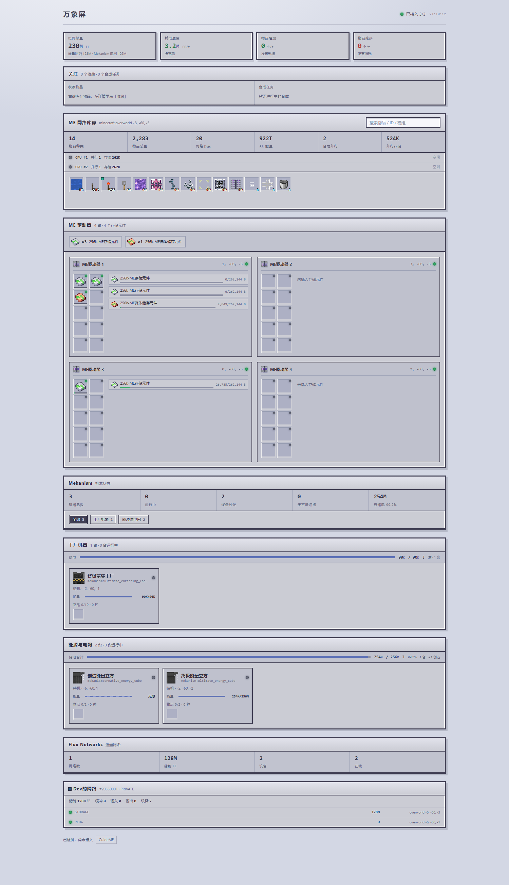

# 万象屏 WanXiangScreen

科技模组挂机，想躺在床上刷视频？万象屏把 AE2、通用机械、Flux Networks等模组的数据推到一个网页上，挂机时仅需看一眼网页、或局域网手机网页查看，甚至可以操作AE继续跑合成。

模组在游戏里跑了个只监听 `127.0.0.1` 的 HTTP 服务，浏览器打开就是实时快照，默认一秒一刷。界面照着 AE2 终端的样式画的，物品图标、数量角标都和游戏里一致。

## 能干什么

**AE2**

- 库存信息，左键看详情，右键直接合成或收藏
- 合成 CPU 的并行数、并行存储、每个任务的实时进度和预计剩余时间
- ME 驱动器逐槽展示：元件类型、状态灯、容量条；兼容第三方扩展驱动器（比如 ExtendedAE）

**通用机械（Mekanism）**

- 监控每台机器工作状态。

**Flux Networks**

- 网络储能监控。

## 安装

进世界时会自动用系统浏览器打开看板（`config/wanxiangscreen-common.toml` 里 `openBrowserOnJoin = false` 可关掉）。地址是 `http://127.0.0.1:18765`，端口被占就顺延，实际端口在游戏目录的 `wanxiangscreen.port` 文件里。

## 配置

都在 `config/wanxiangscreen-common.toml`：

| 项 | 说明 |
| --- | --- |
| `token` | HTTP 鉴权令牌，留空=只允许本机访问 |
| `openBrowserOnJoin` | 进世界自动开看板 |
| `refreshTicks` | 快照刷新间隔，默认 20 tick |
| `simulateMissing` | 测试用 |

## 日志

日志仅保存本模组的WARN/ERROR，路径 `logs/wanxiangscreen-errors.log`

## 协议

模板部分见 `TEMPLATE_LICENSE.txt`，模组代码与资源遵循 `neoforge.mods.toml` 里声明的协议。
